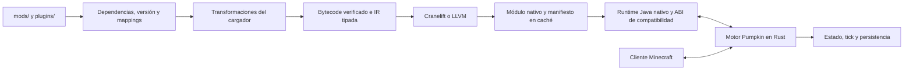

# Arquitectura native-first

## Pumpkin observado

Base de código `87f8822ac36da62102350977be2f62f155a303dc`. Graphify local corresponde a `cd9e98c966919541fe951d78dfdf8d3401e10112`. La consulta de `PluginLoader`, `Context`, `Server`, `DatapackManager` y `BlockRegistry` sirvió para localizar código. Las referencias de la tabla se comprobaron en la revisión actual.

| Área | Evidencia actual |
| --- | --- |
| Arranque | [Binario de Pumpkin](../../../crates/pumpkin/src/main.rs) y [PumpkinServer::init_plugins](../../../crates/pumpkin-core/src/lib.rs) preparan el motor y activan sus cargadores. |
| Protocolo | [pumpkin-data](../../../crates/pumpkin-data/src/generated/packet.rs) fija Minecraft Java 26.3. [Networking Java](../../../crates/pumpkin-core/src/net/java/mod.rs) controla los estados de conexión. |
| Simulación | [Server::tick](../../../crates/pumpkin-core/src/server/mod.rs) llama al ciclo de mundos. [World::tick](../../../crates/pumpkin-core/src/world/mod.rs) ejecuta la simulación de cada mundo. |
| Operaciones del jugador | [Player::request_teleport y Player::teleport_world](../../../crates/pumpkin-core/src/entity/player.rs) actualizan la posición y la sesión de red. [Context](../../../crates/pumpkin-core/src/plugin/api/context.rs) expone registro de comandos y eventos. |
| Registros y guardado | [BlockRegistry](../../../crates/pumpkin-core/src/block/registry.rs), [DatapackManager](../../../crates/pumpkin-core/src/data/datapack/mod.rs), [E/S de chunks](../../../crates/pumpkin-world/src/chunk/io/mod.rs) y [NBT](../../../crates/pumpkin-nbt/src/compound.rs). |
| Extensiones | [Cargador nativo](../../../crates/pumpkin-core/src/plugin/loader/native.rs) comprueba la versión del plugin y carga metadatos Rust. El [host Wasm](../../../crates/pumpkin-wasm-host/src/lib.rs) ofrece otra interfaz. El ABI propuesto para AOT requiere su propia validación. |

## Diseño objetivo

### Instalación y compilación

1. El perfil fija versión de Minecraft, un cargador, versión y lado de ejecución, mappings y API de plugins. El resolvedor lee los metadatos originales, valida dependencias transitivas y produce un orden y un manifiesto reproducibles. Los JAR arbitrarios se consideran datos durante inventario y verificación.
2. Cada adaptador define remapeo y transformaciones en el orden que requiere su cargador. Se registran los hashes del JAR y del bytecode resultante, los Mixins aplicados y los objetivos que no pudieron resolverse. Una combinación sin cobertura se rechaza con clase, método y transformación implicados.
3. El compilador verifica métodos, conserva semántica Java en una IR tipada y genera código máquina. El enlazador resuelve los símbolos del runtime y las importaciones para operar sobre el juego. Las funcionalidades dinámicas fuera del subconjunto provocan un diagnóstico antes de publicar el módulo. [IR, diseño de la prueba y comparativa AOT](AOT.md)
4. La caché indexa contenido, dependencias, Minecraft, mappings, versiones del cargador y transformadores, compilador, ABI, opciones, destino y CPU. Se prepara el artefacto y su manifiesto en temporal y se publica el conjunto después de verificarlo. El servidor acepta únicamente artefactos completos de su perfil. La reconstrucción parcial exige conocer dependientes transitivos e invalidar las transformaciones derivadas.

### Runtime y mundo

El crate expondrá una interfaz C versionada para módulos generados. Un plugin Rust compilado junto al checkout de Pumpkin puede adaptar los puntos de extensión existentes. Los módulos usarán handles opacos con tipo, ámbito y vida útil definidos. La interfaz validará identidad y estado de cada handle antes de acceder al mundo. El contrato incluye resultados y excepciones explícitos, orden y permisos de eventos, registro de comandos y mutaciones aplicadas por Rust en el punto correspondiente del tick.

El runtime nativo debe representar objetos y referencias, metadatos y carga de clases, inicialización, herencia y despacho virtual, excepciones y memoria gestionada. Los módulos que necesiten reflexión, carga dinámica, bibliotecas Java, monitores o modelo de memoria activo requieren implementación y pruebas diferenciales propias. Para las clases de Minecraft se definen contratos contra el motor. Los wrappers y estados gestionados pertenecen al runtime o a la extensión. Las entidades de juego, el orden de ticks y la persistencia siguen siendo de Pumpkin.

La simulación ejecuta operaciones sensibles al orden mediante contratos síncronos. Paralelizar solo cuando se preserven las garantías de Pumpkin. Los datos versionados y referencias se emparejan con el checkout del host antes de activar callbacks. La carga de código máquina requiere una política de confianza o aislamiento específica, ya que el código de proceso tiene los privilegios de Pumpkin.

### Estado y riesgos

| Área | Estado y criterio |
| --- | --- |
| Referencias Java | Teleport Commands y LuckPerms se probaron en una JVM de investigación conectada a Pumpkin. Arclight ejecutó los tres mods de referencia con su propio mundo. Los resultados sirven de oráculo de comportamiento. [Piloto](TELEPORT.md) · [Arclight](REFERENCE.md) |
| Compilación y ABI | Diseño de investigación. Aún faltan traducción de bytecode, emisión de módulos, verificación y runtime nativo. El primer caso exige ejecutar un artefacto en un proceso Rust sin JVM. |
| Mixins y loaders | Paper difiere de las clases que espera Fabric API. El prototipo observó errores de firma e inyección. Los adaptadores AOT deben partir de clases y mappings del perfil y comprobar que sus efectos puedan reproducirse contra Pumpkin. |
| Registro de contenido | Los mods de bloques y entidades requieren registrarlos, persistirlos y sincronizarlos con el cliente. La propuesta upstream de registros dinámicos está abierta. Su disponibilidad en el checkout y su cobertura para mods requieren verificación. [Pumpkin #3887](https://github.com/Pumpkin-MC/Pumpkin/pull/3887) |
| Reproducibilidad | Un cambio en API, mappings, compilador o JAR invalida la parte afectada. Mantener el núcleo upstream sin parches específicos de un cargador o mod y repetir los casos al actualizar. |
