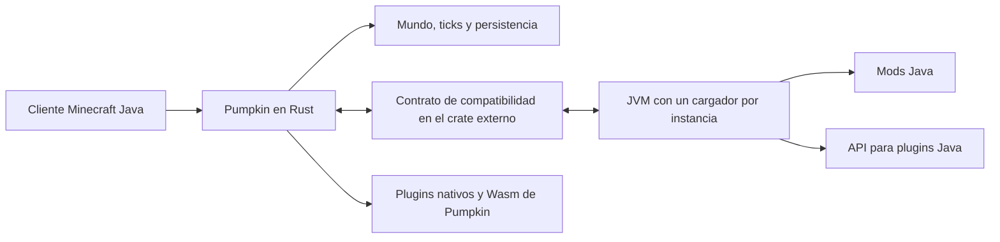

# Arquitectura y límites de integración

## Pumpkin observado en el checkout

Revisión comprobada en fuente `87f8822ac36da62102350977be2f62f155a303dc`. El índice Graphify local se generó para `cd9e98c966919541fe951d78dfdf8d3401e10112`. La consulta de `PumpkinServer`, `PluginLoader` y `ExperienceOrbEntity` orientó la navegación. Las referencias siguientes se comprobaron en el código de la revisión actual.

| Área | Fuente y responsabilidad |
| --- | --- |
| Arranque | [pumpkin](../../../crates/pumpkin/src/main.rs) carga configuración y datos, construye el servidor y prepara los cargadores de plugins. |
| Networking Java | [pumpkin-core](../../../crates/pumpkin-core/src/net/java/mod.rs) gestiona los estados de conexión. [pumpkin-data](../../../crates/pumpkin-data/src/generated/packet.rs) fija el protocolo Java mínimo y máximo en 26.3. |
| Simulación | [Server::tick](../../../crates/pumpkin-core/src/server/mod.rs) actualiza operaciones de servidor y mundos, y [World::tick](../../../crates/pumpkin-core/src/world/mod.rs) ejecuta la simulación de cada mundo. Los orbes usan una [implementación Rust](../../../crates/pumpkin-core/src/entity/experience_orb.rs). |
| Registros y comandos | [Registro de bloques](../../../crates/pumpkin-core/src/block/registry.rs), [registro de entidades](../../../crates/pumpkin-core/src/entity/type.rs) y [dispatcher](../../../crates/pumpkin-core/src/command/commands/mod.rs). |
| Persistencia | [pumpkin-world](../../../crates/pumpkin-world/src/chunk/io/mod.rs) gestiona la E/S de chunks y [pumpkin-nbt](../../../crates/pumpkin-nbt/src/compound.rs) representa compuestos NBT. |
| Extensiones | [PluginLoader](../../../crates/pumpkin-core/src/plugin/loader/mod.rs), [host Wasm](../../../crates/pumpkin-wasm-host/src/lib.rs) y [API de eventos](../../../crates/pumpkin-plugin-api/src/events/mod.rs). Hay eventos de inicio y fin de tick y de aparición de entidad. La aparición por sí sola no expone la semántica de fusión, recogida o persistencia que necesita Clumps. |

## Diseño propuesto

La API de compatibilidad intercambia identificadores, datos y operaciones con precondiciones. Las acciones que alteran el resultado de un tick necesitan orden y respuesta explícitos. Rust valida la operación, confirma la mutación en el punto del tick correspondiente y conserva el estado persistente. Los callbacks asíncronos gestionan E/S o reciben eventos que ya se confirmaron. Un timeout o caída de la JVM debe terminar con un estado observable y sin aplicar dos veces la acción.

Evaluar primero los contratos públicos de Pumpkin para comandos, entidades, eventos, bloques y plugins. Si se demuestra la necesidad de una ampliación, proponer un hook genérico upstream con una prueba que reproduzca la limitación. Mantener el runtime Java, los adaptadores de cargadores y las pruebas en el workspace independiente.

| Riesgo | Dependencia y prueba |
| --- | --- |
| El cliente modificado no negocia con Pumpkin | Priorizar un cargador disponible para el protocolo 26.3 del checkout. Antes de anunciar otra versión, demostrar que se conservan login, configuración, numeración de registros y canales de extensiones. |
| El JAR modifica internals de Minecraft | Inspeccionar sus entradas y mappings. Probar primero un mod Fabric con una superficie reducida. Clumps y Create son pruebas posteriores de Mixins y entidades de bloque. |
| Un plugin depende de CraftBukkit, NMS o reflexión | Evaluar [PatchBukkit](https://github.com/Pumpkin-MC/PatchBukkit), que integra una JVM y Paper en modo headless mediante callbacks a Pumpkin. Comprobar que las operaciones de jugador y mundo usan el estado Rust. |
| Un plugin nativo intercambia layouts de Rust incompatibles | Compilar host y plugin contra la misma revisión y el mismo compilador. Probar login antes de aceptar un binario que parece cargar. |
| Se bloquea el tick o se duplica una mutación | Medir llamadas a Java y probar caída, timeout y reintento en la misma operación con un solo dueño del estado. |
| La actualización de Pumpkin rompe el contrato | Fijar commit, aislar el workspace Cargo y repetir los casos vanilla y modded en cada actualización. |
| AOT cambia resultados o pierde rendimiento | Comparar la misma operación con HotSpot y conservar el fallback verificable. Invalidar por JAR, dependencias, runtime, cargador, mappings, transformaciones y CPU. |

La instancia de referencia de la hoja de ruta emplea Arclight y su propio mundo de prueba para observar los JAR originales. Es un perfil ejecutable de contraste para la arquitectura propuesta.
